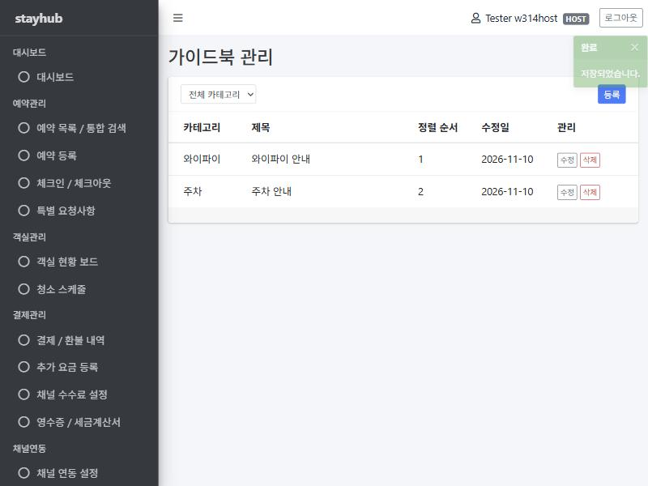

# 새 관리자 화면 만드는 법

숙소 가이드북 화면(SCR-CMS-02·03)이 **참고 구현**입니다. 관리자 화면은 전부 아래 세 유형 중 하나를 복사해 만듭니다
(정책정의서 "화면 퍼블리싱 방식"). 새로운 UI 방식이 필요해 보이면 만들기 전에 정기 회의 안건으로 올리세요.

API 를 먼저 만드세요([how-to-new-feature.md](how-to-new-feature.md)). 화면은 그 API 를 부르기만 합니다.
서버에서 Model 에 데이터를 담아 그리지 않습니다. 화면의 `<script>` 가 `api()` 로 `/api/**` 를 불러 그립니다.



## 순서

### ① 어떤 유형을 복사할지 고르기

화면목록정의서의 "유형" 칸을 보세요.

| 유형 | 복사할 파일 (`src/main/resources/templates/admin/guidebooks/`) | 예 |
| --- | --- | --- |
| 목록 | `list.html` — 표·검색 조건·페이지네이션·빈 목록·[등록] | 예약 목록(RSV-01), 결제/환불 내역(PAY-01), 동기화 로그(CHN-02) |
| 편집 폼 | `form.html` — 등록·수정 한 파일, 필수 별표, 입력값 오류 표시 | 예약 등록(RSV-03), 채널 연동 설정(CHN-01), 소개페이지 편집(CMS-01) |
| 팝업 | `list.html` 의 `remove()` + `layout.html` 맨 아래 `#confirmModal` 모양 | 삭제 확인, 객실 상태 변경(ROM-02), 추가 요금 등록(PAY-02) |

함께 복사할 Java 파일은 하나입니다: `content/controller/GuidebookPageController.java` → 내 도메인의 `controller/XxxPageController.java`.

**복사하지 않는 파일** — 모든 화면이 같이 씁니다.
`templates/admin/layout.html`, `static/js/stayhub.js`, `static/css/stayhub.css`, `common/AdminMenu.java`,
`common/AdminPageInterceptor.java`, `common/controller/AdminController.java`

### ② 바꿀 곳 고치기

복사한 파일에서 `★ 바꿀 곳` 으로 검색합니다 (IntelliJ `Ctrl + Shift + F`). 각 파일 맨 위 주석에 "따라 만들 때 바꿀 곳"이 정리돼 있습니다.

- **화면 파일 맨 위** — `layout('화면 제목', ~{::section})` 의 제목. 레이아웃이 탭 제목과 본문 제목에 씁니다
- **`<script>` 맨 위 상수** — `API_URL`(내 API), `PAGE_URL`/`LIST_URL`(내 화면 주소)
- **목록** — `<th>` 제목 줄과 `renderRows` 의 `<td>` 수를 같게. 사용자가 입력한 글자는 `esc()` 로 감싸기.
  날짜는 `formatDate`(목록)·`formatDateTime`(상세·로그), 금액은 `formatMoney`
- **편집 폼** — 입력칸의 `name` 을 요청 DTO 필드 이름과 **한 글자도 다르지 않게**. 같아야 `formToJson` 이 그 이름으로 보내고,
  서버 검증 오류가 그 칸 아래에 붙습니다. 필수 칸(DTO 에 `@NotNull`·`@NotBlank`)은 `<label class="required">`
- **삭제 기능이 없는 테이블(유형 ②·③)** — `list.html` 의 [삭제] 버튼과 `remove()` 를 지웁니다
- **입력 팝업**(ROM-02, PAY-02 등) — `layout.html` 맨 아래 `#confirmModal` 을 내 화면 `<section>` 안에 복사하고
  `id` 를 바꾼 뒤, `modal-body` 에 `form.html` 의 입력칸을 넣습니다. 열기는 `$('#내모달').modal('show')`,
  저장은 `form.html` 의 submit 코드와 같습니다(성공하면 `modal('hide')` → `toast` → `load(currentPage)`)

`stayhub.js` 에 있는 함수(파일 맨 위에 목록)는 그냥 부르면 됩니다. 화면에 비슷한 함수를 새로 만들지 마세요.

| 정책정의서 | 쓰는 법 |
| --- | --- |
| 저장 성공 토스트(우측 상단 3초) | `toast('저장되었습니다.')` — 바로 다른 화면으로 이동해도 이어서 보입니다 |
| 삭제 확인(기본 포커스 [취소]) | `if (!(await confirmDelete('삭제할까요?'))) return;` |
| 입력값 오류(인라인 + 빨간 테두리) | `catch (error) { showFormError(form, error); }` |
| 빈 목록 / 페이징 20건 | `renderRows(...)` / `renderPagination(el, page, load)` |
| 서버 오류 팝업 · 세션 만료 · 403 | `api()` 가 알아서 합니다. 화면에서 따로 처리하지 않습니다 |

### ③ 메뉴에 이미 있는지 확인하기

`common/AdminMenu.java` 에서 내 화면 ID(예: `SCR-ROM-01`)를 찾습니다. 사이트맵_IA 의 1차 범위 관리자 메뉴는 이미 다 들어 있습니다.

- **있으면** — 적힌 `url` 을 내 `XxxPageController` 의 `@RequestMapping` 에 그대로 씁니다. enum 은 고치지 않습니다.
  컨트롤러가 생기기 전까지 그 주소는 "준비 중" 화면이 뜹니다
- **없으면** — 메뉴가 아닌 화면입니다(예: 예약 상세 SCR-RSV-02는 목록에서 들어감). 목록 화면 아래 주소를 씁니다.
  예) `/admin/reservations/{id}`. 메뉴에 넣어야 할 것 같으면 총괄에게 묻습니다
- 역할별 메뉴 노출은 enum 의 역할 목록으로 정해집니다. 고치려면 사이트맵을 먼저 고쳐야 하니 총괄과 상의하세요

### ④ AI에게 요청하기

아래 틀을 그대로 복사해서 `[ ]` 부분만 채워 넣으세요.

```
templates/admin/guidebooks/[list.html / form.html] 과 content/controller/GuidebookPageController.java 를
참고해서, 똑같은 구조로 [화면 ID 화면명] 화면을 만들어줘.
화면 주소: [AdminMenu 에 적힌 url]
부를 API: [컨트롤러 Javadoc 의 주소 목록 붙여넣기]
응답·요청 DTO: [XxxResponse / XxxCreateRequest 필드 붙여넣기]
- ★ 바꿀 곳만 바꾸고, 파일 맨 위 주석도 내 화면에 맞게 고칠 것
- stayhub.js 의 함수(api, toast, renderRows, renderPagination, showFormError, formToJson, fillForm,
  confirmDelete, formatDate, formatMoney, esc)만 쓰고 비슷한 함수를 새로 만들지 말 것
- 화면에 표시하는 사용자 입력값은 전부 esc() 로 감쌀 것
- 새 라이브러리·CDN·CSS 프레임워크를 추가하지 말 것 (AdminLTE 3.2.0 만)
- Model 에 데이터를 담지 말고 api() 로 불러올 것
```

예) `[list.html / form.html]` → `list.html`, `[화면 ID 화면명]` → `SCR-ROM-01 객실 현황 보드`,
`[AdminMenu 에 적힌 url]` → `/admin/rooms`, `[컨트롤러 Javadoc 의 주소 목록 붙여넣기]` → `RoomController` 위의 `<pre>` 블록

### ⑤ 확인하기

1. **앱 실행 후 로그인** — <http://localhost:8080/login>. 계정이 없으면 [troubleshooting.md](troubleshooting.md)의
   "401" 항목대로 회원가입합니다(가입하면 역할이 `STAFF` 라 대시보드 메뉴만 보입니다)
2. **개발할 때 메뉴가 다 보이게** — MySQL 에서 내 계정을 HOST 로 바꾸고 다시 로그인합니다(역할은 로그인할 때 세션에 들어갑니다).
   ```sql
   UPDATE users SET role='HOST' WHERE login_id='본인아이디';
   ```
   역할별로 메뉴가 맞게 보이는지 볼 때는 `'FRONT'`, `'CLEANING'` 으로 바꿔 다시 로그인합니다
3. **화면 확인** — 좌측 메뉴에서 내 화면을 눌러 목록·등록·수정·삭제를 한 번씩. 함께 확인할 것:
   - 빈칸으로 저장 → 칸 아래 빨간 메시지
   - 데이터가 없을 때 "조회된 데이터가 없습니다"
   - 21건 이상이면 페이지 번호
   - 브라우저 개발자 도구(F12) Console 에 빨간 에러가 없는지
4. **테스트** — `./gradlew test`
5. **PR "확인한 것"** — 위 3번에서 해본 것을 적고, 가능하면 화면 캡처를 붙입니다

막히면 [troubleshooting.md](troubleshooting.md)의 "화면 확인"을 먼저 보세요.
